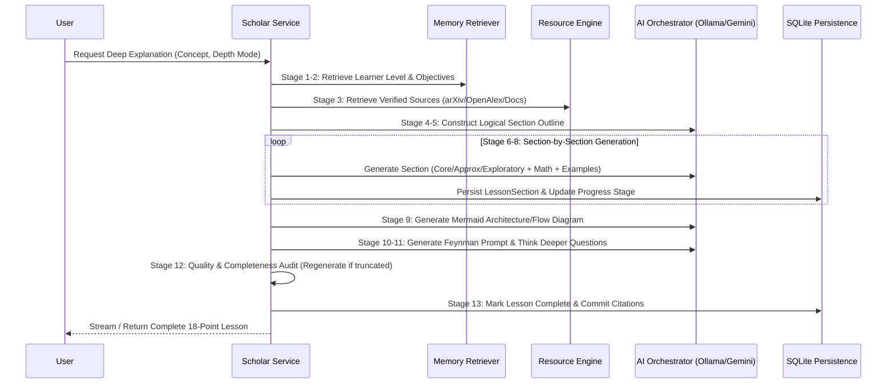

# AI Architecture, Provider Abstraction & Multi-Stage Generation
## Axiom OS — Local-First AI Orchestration Layer

---

## 1. AI Provider Abstraction (`AIProvider`)

All AI interactions flow through a unified, provider-agnostic abstract interface in `backend/app/providers/base.py`:

```python
class AIProvider(ABC):
    @abstractmethod
    async def health_check(self) -> ProviderHealthStatus: ...
    @abstractmethod
    async def list_models(self) -> list[ModelDescriptor]: ...
    @abstractmethod
    async def generate(self, prompt: str, system_prompt: str = "", model: str | None = None, temperature: float = 0.3) -> GenerationResult: ...
    @abstractmethod
    async def generate_structured(self, prompt: str, schema: type[BaseModel], system_prompt: str = "", model: str | None = None) -> BaseModel: ...
    @abstractmethod
    async def stream(self, prompt: str, system_prompt: str = "", model: str | None = None) -> AsyncIterator[str]: ...
    @abstractmethod
    def estimate_context(self, text: str) -> ContextEstimate: ...
    @abstractmethod
    def get_capabilities(self) -> ProviderCapabilities: ...
```

### Supported Providers
1. **`OllamaProvider` (Primary Default — Local, Zero Cost, Private)**
   - Connects to `http://localhost:11434`.
   - Automatically detects installed models (`qwen3.5:4b`, `gemma3:4b`, `nomic-embed-text:latest` verified on host).
   - Uses Ollama's native `format` parameter with JSON Schema enforcement + Pydantic validation and automatic self-healing retry if malformed JSON is returned.
   - Never downloads models without explicit user action (`ollama pull` is only surfaced as an explicit user-triggered command with size, VRAM requirement, and license disclosure).
2. **`GeminiProvider` (Optional Cloud Provider — Disabled by Default)**
   - Uses official Google Gemini REST interface (`generativelanguage.googleapis.com/v1beta/models`).
   - Requires explicit user opt-in (`allow_cloud_ai = True`) and user-supplied API key.
   - Displays clear privacy notice regarding free-tier vs. paid-tier data handling.
   - Dynamically lists available models via `/v1beta/models` rather than permanently hard-coding deprecated model IDs.
3. **`DeterministicSynthesisFallback` (Resilience Guarantee)**
   - When Ollama is stopped or a model times out during heavy multi-stage generation, the orchestrator combines structured domain templates, retrieved academic citations, and mathematical derivations so the application never crashes or returns empty screens. Every response transparently badges its provenance (`Local Ollama`, `Cloud Gemini`, or `Local Structured Synthesis`).

---

## 2. Hardware-Aware Model Recommender

Before recommending any local model in Settings, `HardwareInspector` inspects:
- **OS**: Windows 11
- **CPU**: Intel Core i9-12900HX (16C/24T)
- **System RAM**: 32.0 GB
- **GPU & VRAM**: NVIDIA RTX A4500 Laptop GPU with **16,384 MiB (16 GB) VRAM** via `nvidia-smi`
- **Free Disk Space**: ~256.7 GB on `D:`

| Candidate Model | Approx. Download | VRAM Required | Host Compatibility on RTX A4500 (16 GB) | License & Usage Notes |
| :--- | :--- | :--- | :--- | :--- |
| **`qwen3.5:4b`** *(Installed)* | 3.4 GB | ~3.8 GB | **Optimal Fast Local** (Runs 100% in VRAM with 16k+ context) | Apache 2.0 (Tongyi Qianwen) |
| **`gemma3:4b`** *(Installed)* | 3.3 GB | ~3.6 GB | **Optimal Fast Local** (Runs 100% in VRAM with 16k+ context) | Gemma Terms of Use (Google custom open-weight license; not OSI open-source) |
| **`qwen3:8b`** *(Candidate)* | 5.2 GB | ~6.5 GB | **Recommended Balanced** (Fits comfortably in 16 GB VRAM) | Apache 2.0 |
| **`gemma3:12b`** *(Candidate)* | 8.1 GB | ~10.0 GB | **Recommended High-Depth** (Fits in 16 GB VRAM) | Gemma Terms of Use (custom restrictions apply) |
| **`qwen3:14b`** *(Candidate)* | 9.3 GB | ~11.5 GB | **Maximum Local Depth** (Fits in 16 GB VRAM; limit context to 8k–16k) | Apache 2.0 |

---

## 3. The 18 Specialised AI Services (`AIOrchestrator`)

Instead of a monolithic chatbot, `backend/app/services/ai_orchestrator.py` coordinates 18 domain-specific services, each with its own Pydantic output schema, targeted memory retrieval, and validation pipeline:

1. **Intent Understanding Service** (`parse_learning_intent`)
2. **Research Planning Service** (`plan_research_strategy`)
3. **Prerequisite Discovery Service** (`discover_prerequisites`)
4. **Blueprint Generation Service** (`generate_learning_blueprint`)
5. **Concept Graph Generation Service** (`generate_concept_graph`)
6. **Resource Search Planning Service** (`plan_resource_queries`)
7. **Resource Ranking Service** (`rank_and_classify_resources`)
8. **Deep Explanation Generation Service** (`generate_deep_explanation_multistage`)
9. **Feynman Mentor Service** (`evaluate_feynman_explanation`)
10. **Active Recall Generator Service** (`generate_active_recall_suite`)
11. **Think Deeper Generator & Socratic Evaluator** (`generate_think_deeper` / `evaluate_think_deeper_response`)
12. **Project Journey Generator Service** (`generate_project_milestones`)
13. **Architecture Mentor Service** (`generate_architecture_specification`)
14. **Implementation Mentor Service** (`provide_progressive_hint`)
15. **Debugging Assistant Service** (`analyze_bug_and_guide_fix`)
16. **Experiment Analyst Service** (`interpret_experiment_outcomes`)
17. **Knowledge Memory Manager Service** (`extract_and_update_memories`)
18. **Session Resume Generator Service** (`generate_session_resume_brief`)

---

## 4. Multi-Stage Deep Explanation Pipeline

To guarantee university-quality explanations without single-pass truncation:


