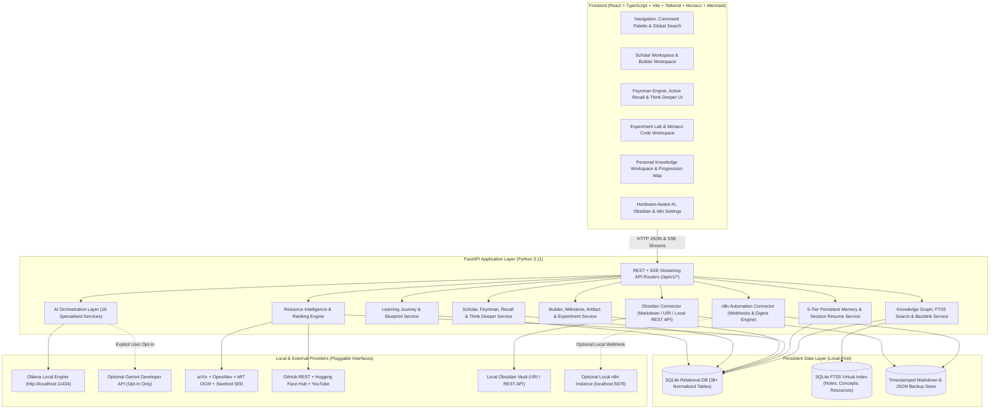

# System Architecture & Hardware Profile
## Axiom OS — Personal AI Research, Learning & Creation OS

---

## 1. Inspected Workspace & Host Hardware Profile

During Phase 0 inspection of `d:\Learn Anything`, the following host environment was verified:

| Component | Detected Specification | Architectural Implication |
| :--- | :--- | :--- |
| **OS** | Windows 11 (x64) | PowerShell native scripts + cross-platform Python/Node compatibility |
| **System Model** | Lenovo ThinkPad P16 Gen 1 (`21D7S18600`) | High-performance mobile workstation |
| **CPU** | 12th Gen Intel Core i9-12900HX (16 Cores, 24 Logical Processors) | Excellent concurrency for FastAPI async workers, FTS5 indexing, and compilation |
| **System RAM** | 32 GB (`34,044,170,240` bytes) | Ample memory for concurrent IDE, browser, FastAPI, Vite, and local LLM context |
| **Dedicated GPU** | NVIDIA RTX A4500 Laptop GPU (**16 GB VRAM** / `16,384 MiB`, CUDA 13.2, Driver `596.52`) | **Capable of running 4B–14B quantized local models entirely in VRAM** at high token/sec speeds |
| **Storage** | `C:` 267.41 GB free; `D:` 256.74 GB free | Over 520 GB total free SSD space; safe for SQLite databases, artifacts, and models |
| **Python** | Python `3.11.9` | Supports modern FastAPI, SQLAlchemy 2.0, Pydantic v2, Alembic, and Pytest |
| **Node.js / npm** | Node `v24.19.0` / npm `11.17.0` | Supports Vite, React 18/19, TypeScript, Tailwind CSS, Vitest, Playwright, and `npx n8n` |
| **Ollama** | `ollama version 0.40.16` installed & running | Local models already present: `qwen3.5:4b` (3.4 GB), `gemma3:4b` (3.3 GB), `nomic-embed-text:latest` (274 MB), `glm-5.3:cloud` |
| **Docker** | Not installed (`docker` CLI absent) | n8n integration provides both `docker-compose.yml` AND zero-Docker native Node (`npx n8n`) execution |

### Hardware Risks & Mitigations
1. **WMI 32-bit VRAM Reporting Quirk**: Windows `Win32_VideoController.AdapterRAM` overflows at 4 GB (`4293918720`). Our backend hardware detector queries `nvidia-smi --query-gpu=name,memory.total,memory.free --format=csv,noheader,nounits` first (which accurately detects `16384 MiB` on the RTX A4500), falling back to WMI only when `nvidia-smi` is unavailable.
2. **Local Model Context Length vs VRAM**: While 4B models (`qwen3.5:4b`, `gemma3:4b`) use ~3.5 GB VRAM and leave ~12 GB free for large context windows (16k–32k), 14B models (`qwen3:14b`) use ~9.5–11 GB VRAM. The AI Provider Engine dynamically recommends context sizes based on model footprint vs. free VRAM.

---

## 2. High-Level Layered Architecture



---

## 3. Repository Directory Structure

```text
d:\Learn Anything\
├── AGENTS.md
├── README.md
├── .env.example
├── .gitignore
├── docker-compose.n8n.yml
├── start-axiom.ps1
├── start-axiom.sh
├── docs/
│   ├── PRD.md
│   ├── ARCHITECTURE.md
│   ├── DATA_MODEL.md
│   ├── AI_ARCHITECTURE.md
│   ├── RESOURCE_DISCOVERY.md
│   ├── OBSIDIAN_INTEGRATION.md
│   ├── N8N_INTEGRATION.md
│   ├── SECURITY.md
│   ├── IMPLEMENTATION_PLAN.md
│   ├── TESTING_PLAN.md
│   ├── INSTALLATION.md
│   ├── CONFIGURATION.md
│   ├── USER_GUIDE.md
│   └── BACKUP_AND_RESTORE.md
├── backend/
│   ├── pyproject.toml
│   ├── requirements.txt
│   ├── alembic.ini
│   ├── alembic/
│   │   ├── env.py
│   │   └── versions/
│   ├── app/
│   │   ├── main.py
│   │   ├── config.py
│   │   ├── database.py
│   │   ├── models/          # 38+ SQLAlchemy 2.0 relational models + FTS5 triggers
│   │   ├── schemas/         # Validated Pydantic v2 schemas for API & AI outputs
│   │   ├── providers/       # AIProvider base, OllamaProvider, GeminiProvider, HardwareInspector
│   │   ├── services/        # 18 AI Orchestration services, Scholar, Builder, Resource, Obsidian, n8n
│   │   ├── routers/         # Modular FastAPI routers
│   │   └── seed/            # Rich, authentic seed journeys (Transformers/TinyGPT, OS from Scratch, AI in 30 Days)
│   └── tests/               # Pytest unit & integration suite (Acceptance Tests A–I)
├── frontend/
│   ├── package.json
│   ├── vite.config.ts
│   ├── tsconfig.json
│   ├── index.html
│   ├── src/
│   │   ├── api/             # Typed API client & SSE stream handlers
│   │   ├── types/           # Complete TypeScript domain interfaces
│   │   ├── context/         # Global state (Active Journey, Road Mode, Theme, AI Status, Command Palette)
│   │   ├── components/      # Shared UI, Knowledge Graph, Mermaid Renderer, Monaco Editor, Command Palette
│   │   ├── pages/           # 12 core screens (Onboarding, Home, Explore, Blueprint, Scholar, Builder, etc.)
│   │   └── test/            # Vitest + React Testing Library tests
│   └── e2e/                 # Playwright end-to-end browser verification tests
└── n8n_workflows/           # 7 ready-to-import JSON workflow definitions
```
