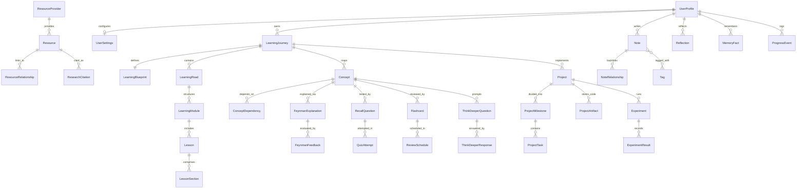

# Database Schema & Relational Data Model
## Axiom OS — SQLite + SQLAlchemy 2.0 + FTS5 + Alembic

---

## 1. Design Philosophy

1. **Normalized Relational Integrity**: All 38 core entities required by Section 19 of the specification are represented as explicit SQLAlchemy models with primary keys, foreign key constraints, indexes, and `created_at` / `updated_at` timestamps.
2. **PostgreSQL Compatibility**: Column types use standard SQLAlchemy primitives (`String`, `Text`, `Integer`, `Float`, `Boolean`, `DateTime`, `ForeignKey`, and structured `JSON` only for genuinely flexible payloads like diagram metadata or raw provider headers) so switching `DATABASE_URL` from `sqlite:///./axiom.db` to `postgresql+psycopg://...` requires zero model rewrites.
3. **Full-Text Search (SQLite FTS5)**: A virtual FTS5 table `fts_search_index` indexes concepts, lessons, notes, projects, experiments, and resources for sub-millisecond global search across the workspace.

---

## 2. Entity-Relationship Overview

---

## 3. Complete Model Catalogue (38 Models)

### A. User, Settings & System Configuration
1. **`UserProfile`** (`user_profiles`): `id`, `name`, `bio`, `experience_level`, `preferred_format`, `daily_minutes_goal`, `total_xp`, `current_level`, `exploration_rank`, `created_at`, `updated_at`.
2. **`UserSettings`** (`user_settings`): `id`, `user_id` (FK), `theme` (`dark`/`light`), `default_road_mode` (`scholar`/`builder`/`hybrid`), `default_explanation_depth` (`concise`/`detailed`/`research`), `allow_cloud_ai`, `allow_code_execution`, `allow_telemetry` (false), `updated_at`.
3. **`AIProviderConfig`** (`ai_provider_configs`): `id`, `provider_name` (`ollama`/`gemini`/`openai_compatible`), `is_enabled`, `is_default`, `base_url`, `encrypted_api_key`, `default_model`, `task_routing_json` (models per task: explanation, research, coding, classification, questions), `context_length`, `temperature`, `last_health_check`, `health_status`.
4. **`IntegrationConfig`** (`integration_configs`): `id`, `integration_type` (`obsidian`/`n8n`/`github`/`youtube`), `is_enabled`, `endpoint_url`, `auth_token`, `approved_folders_json`, `read_permission`, `write_permission`, `last_verified_at`, `status_message`.
5. **`BackupRecord`** (`backup_records`): `id`, `backup_type` (`full_json`/`markdown_vault`/`sqlite_snapshot`), `file_path`, `size_bytes`, `item_count`, `triggered_by` (`manual`/`n8n`/`pre_sync`), `created_at`.

### B. Journeys, Blueprints, Roads & Concept Graph
6. **`LearningJourney`** (`learning_journeys`): `id`, `user_id` (FK), `title`, `slug`, `user_intent`, `subject_domain`, `road_mode` (`scholar`/`builder`/`hybrid`), `experience_level`, `daily_minutes`, `duration_days`, `status` (`active`/`completed`/`paused`), `progress_percent`, `current_road`, `current_concept_id`, `current_milestone_id`, `last_active_at`, `created_at`.
7. **`LearningBlueprint`** (`learning_blueprints`): `id`, `journey_id` (FK), `objective`, `what_will_be_created`, `why_it_matters`, `deliverables_json`, `required_knowledge_json`, `proposed_architecture`, `tools_and_tech_json`, `alternative_approaches_json`, `failure_modes_json`, `estimated_hours`, `stretch_goals_json`, `is_approved`, `version`, `updated_at`.
8. **`LearningRoad`** (`learning_roads`): `id`, `journey_id` (FK), `road_type` (`scholar`/`builder`), `title`, `description`, `sequence_order`, `progress_percent`.
9. **`Concept`** (`concepts`): `id`, `journey_id` (FK), `slug`, `title`, `summary`, `category` (`foundational`/`prerequisite`/`mathematical`/`terminology`/`intermediate`/`advanced`/`related`/`research_direction`), `difficulty_level`, `mastery_status` (`unstarted`/`exploring`/`practicing`/`synthesized`), `mastery_score`, `position_x`, `position_y`, `builder_milestone_id` (nullable link to Builder Road), `created_at`.
10. **`ConceptDependency`** (`concept_dependencies`): `id`, `source_concept_id` (FK), `target_concept_id` (FK), `dependency_type` (`essential`/`recommended`/`optional`), `rationale`.

### C. Scholar Road: Modules, Multi-Stage Lessons & Sessions
11. **`LearningModule`** (`learning_modules`): `id`, `road_id` (FK), `title`, `description`, `sequence_order`, `estimated_minutes`, `unlock_status`.
12. **`Lesson`** (`lessons`): `id`, `module_id` (FK), `concept_id` (FK), `title`, `learning_format`, `current_depth` (`concise`/`detailed`/`research`), `generation_stage` (`complete`/`generating`/`interrupted`), `problem_statement`, `why_it_exists`, `historical_context`, `first_principles_intuition`, `real_world_analogies`, `mermaid_diagram`, `worked_examples`, `code_examples`, `common_misconceptions`, `limitations`, `is_completed`, `updated_at`.
13. **`LessonSection`** (`lesson_sections`): `id`, `lesson_id` (FK), `section_key`, `title`, `sequence_order`, `epistemic_label` (`CORE`/`APPROXIMATE`/`EXPLORATORY`), `concise_content`, `detailed_content`, `research_content`, `mathematical_derivation`, `citations_json`, `is_expanded`.
14. **`LearningSession`** (`learning_sessions`): `id`, `user_id` (FK), `journey_id` (FK), `active_road`, `concept_id` (FK), `project_id` (FK), `started_at`, `ended_at`, `duration_minutes`, `summary`, `incomplete_task`, `next_recommended_action`.
15. **`LearningTask`** (`learning_tasks`): `id`, `journey_id` (FK), `concept_id` (FK), `milestone_id` (FK), `title`, `task_type` (`study`/`feynman`/`recall`/`think_deeper`/`build`/`experiment`), `status` (`pending`/`in_progress`/`completed`), `due_date`, `completed_at`.

### D. Feynman Engine, Active Recall & Think Deeper
16. **`FeynmanExplanation`** (`feynman_explanations`): `id`, `concept_id` (FK), `user_id` (FK), `version_number`, `stage_reached` (1 to 6), `intuition_prompt`, `user_explanation`, `revised_explanation`, `formal_precision_notes`, `remaining_uncertainties`, `created_at`.
17. **`FeynmanFeedback`** (`feynman_feedbacks`): `id`, `explanation_id` (FK), `incorrect_assumptions_json`, `missing_relationships_json`, `logical_gaps_json`, `memorised_jargon_json`, `evidence_quotes_json`, `guided_questions_json`, `analogies_and_hints_json`, `clarity_score`, `created_at`.
18. **`RecallQuestion`** (`recall_questions`): `id`, `concept_id` (FK), `question_type` (`free_recall`/`short_answer`/`concept_reconstruction`/`mcq`/`derivation`/`problem_solving`/`compare_contrast`/`explain_difference`/`practical_application`), `prompt`, `options_json`, `reference_answer`, `grading_rubric`, `difficulty`.
19. **`Flashcard`** (`flashcards`): `id`, `concept_id` (FK), `front`, `back`, `hint`, `card_type` (`conceptual`/`mathematical`/`code`/`tradeoff`), `created_at`.
20. **`ReviewSchedule`** (`review_schedules`): `id`, `flashcard_id` (FK), `concept_id` (FK), `next_review_at`, `interval_days`, `ease_factor`, `repetitions`, `stability_score`, `last_reviewed_at`, `last_outcome` (`again`/`hard`/`good`/`easy`).
21. **`QuizAttempt`** (`quiz_attempts`): `id`, `question_id` (FK), `user_id` (FK), `user_response`, `ai_feedback`, `evidence_score`, `demonstrated_understanding`, `attempted_at`.
22. **`ThinkDeeperQuestion`** (`think_deeper_questions`): `id`, `concept_id` (FK, nullable), `milestone_id` (FK, nullable), `question_category` (`first_principles`/`assumption_analysis`/`counterfactual`/`tradeoff`/`systems_thinking`/`failure_investigation`/`cross_disciplinary`), `prompt`, `optional_hint`, `socratic_guide`, `model_research_discussion`.
23. **`ThinkDeeperResponse`** (`think_deeper_responses`): `id`, `question_id` (FK), `user_id` (FK), `user_reasoning`, `identified_assumptions_json`, `missing_perspectives_json`, `socratic_followup_question`, `followup_user_reply`, `model_discussion_unlocked`, `created_at`.

### E. Builder Road: Projects, Milestones, Artifacts & Experiment Lab
24. **`Project`** (`projects`): `id`, `journey_id` (FK), `title`, `slug`, `domain`, `objective`, `architecture_overview`, `architecture_mermaid`, `tech_stack_json`, `connected_local_dir`, `status` (`planning`/`building`/`experimenting`/`completed`), `current_milestone_order`, `outstanding_bugs_json`, `implementation_decisions_json`, `next_action`, `created_at`, `updated_at`.
25. **`ProjectMilestone`** (`project_milestones`): `id`, `project_id` (FK), `concept_id` (FK, nullable link to Scholar theory), `sequence_order`, `title`, `mission`, `why_this_matters`, `prerequisites_json`, `architecture_design`, `architecture_diagram`, `pseudocode`, `step_by_step_guide`, `code_explanation`, `basic_tests_json`, `edge_cases_json`, `break_it_challenges_json`, `deliverable_description`, `reflection_prompts_json`, `hint_level_1_conceptual`, `hint_level_2_approach`, `hint_level_3_pseudocode`, `hint_level_4_snippet`, `hint_level_5_full`, `unlocked_hint_level`, `status` (`locked`/`active`/`completed`), `completed_at`.
26. **`ProjectTask`** (`project_tasks`): `id`, `milestone_id` (FK), `title`, `file_target`, `description`, `verification_command`, `is_completed`.
27. **`ProjectArtifact`** (`project_artifacts`): `id`, `project_id` (FK), `milestone_id` (FK, nullable), `file_path`, `language`, `content`, `previous_content`, `artifact_type` (`source_code`/`test_suite`/`architecture_doc`/`config`), `version`, `updated_at`.
28. **`Experiment`** (`experiments`): `id`, `project_id` (FK), `milestone_id` (FK, nullable), `concept_id` (FK, nullable), `title`, `hypothesis`, `objective`, `variables_changed_json`, `procedure`, `expected_outcome`, `actual_outcome`, `observations`, `conclusion`, `next_experiment_suggestion`, `status` (`planned`/`running`/`succeeded`/`refuted`/`failed_instructively`), `ai_interpretation`, `created_at`.
29. **`ExperimentResult`** (`experiment_results`): `id`, `experiment_id` (FK), `run_number`, `parameters_json`, `metrics_json`, `log_output`, `chart_data_json`, `recorded_at`.

### F. Resource Intelligence & Citations
30. **`ResourceProvider`** (`resource_providers`): `id`, `name` (`github`/`youtube`/`openalex`/`arxiv`/`huggingface`/`mit_ocw`/`stanford_see`/`official_docs`/`coursera`/`udemy`), `base_url`, `requires_api_key`, `rate_limit_remaining`, `last_queried_at`.
31. **`Resource`** (`resources`): `id`, `provider_id` (FK), `external_id`, `title`, `url`, `resource_type` (`paper`/`repository`/`video`/`course`/`lecture`/`documentation`/`article`/`model`/`dataset`), `authors_json`, `published_date`, `access_status` (`Completely free`/`Free audit`/`Free learning, paid certificate`/`Free preview only`/`Paid`/`Unverified`), `license_info`, `description`, `relevance_explanation`, `credibility_score`, `relevance_score`, `difficulty_level`, `stars_or_citations`, `duration_or_length`, `thumbnail_url`, `is_saved_to_library`, `last_verified_at`.
32. **`ResourceRelationship`** (`resource_relationships`): `id`, `resource_id` (FK), `concept_id` (FK, nullable), `project_id` (FK, nullable), `milestone_id` (FK, nullable), `recommendation_tier` (`primary`/`supplementary`/`practical_repo`/`explore_more`).
33. **`ResearchCitation`** (`research_citations`): `id`, `resource_id` (FK, nullable), `lesson_section_id` (FK, nullable), `citation_key`, `authors`, `year`, `title`, `venue_or_source`, `url`, `doi_or_arxiv_id`, `claim_supported`, `epistemic_status` (`CORE`/`APPROXIMATE`/`EXPLORATORY`), `methodology_limitations`.

### G. Personal Knowledge Workspace, Memory & Progression
34. **`Note`** (`notes`): `id`, `user_id` (FK), `concept_id` (FK, nullable), `project_id` (FK, nullable), `title`, `slug`, `content_markdown`, `note_type` (`concept_note`/`research_summary`/`project_journal`/`question`/`daily_log`), `obsidian_path`, `last_synced_at`, `created_at`, `updated_at`.
35. **`Tag`** (`tags`) & `note_tags` association table: `id`, `name`, `color`.
36. **`NoteRelationship`** (`note_relationships`): `id`, `source_note_id` (FK), `target_note_id` (FK), `relationship_type` (`wikilink`/`related_idea`/`contradicts`/`builds_upon`), `context_snippet`.
37. **`Reflection`** (`reflections`): `id`, `user_id` (FK), `milestone_id` (FK, nullable), `concept_id` (FK, nullable), `what_built_or_learned`, `why_it_works`, `what_failed`, `what_surprised`, `what_to_change`, `created_at`.
38. **`MemoryFact`** (`memory_facts`): `id`, `user_id` (FK), `memory_category` (`learner`/`knowledge`/`research`/`project`/`session`), `subject_key`, `fact_statement`, `confidence`, `source_entity_type`, `source_entity_id`, `is_active`, `created_at`, `updated_at`.
39. **`ProgressEvent`** (`progress_events`): `id`, `user_id` (FK), `journey_id` (FK, nullable), `event_type` (`concept_synthesized`/`feynman_completed`/`think_deeper_answered`/`milestone_built`/`experiment_logged`/`break_it_completed`), `title`, `xp_awarded`, `metadata_json`, `created_at`.
